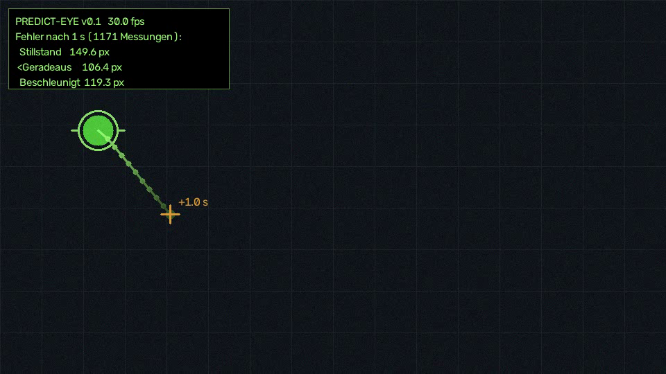
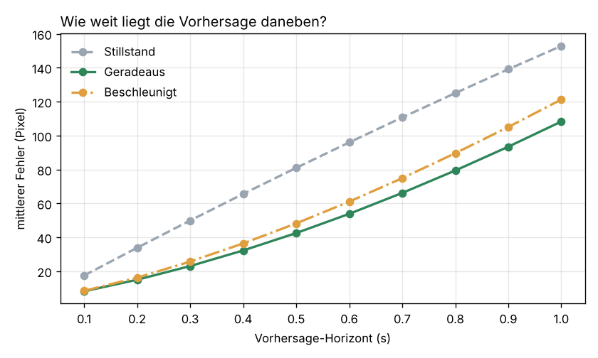
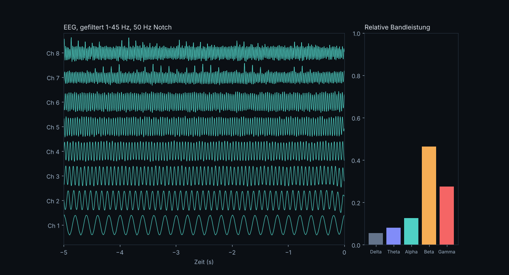

# NeuroHUD-Prototypen

Erste Bausteine für mein Langzeitprojekt: ein elektronisches „Vorhersage-Auge“, das einblendet, wo sich Dinge in der nächsten Sekunde wahrscheinlich befinden, und das sich später über Gehirnsignale (BCI) steuern lässt.

Der erste Schritt ist kein Implantat. Er ist eine Frage, die man messen kann:
**Wie gut lässt sich Bewegung 1 Sekunde vorhersagen, und wie schnell wächst der Fehler?**

Das Repo besteht aus zwei Teilen:

| Ordner | Was es macht |
|---|---|
| `vision/` | Verfolgt ein Objekt mit der Kamera, sagt seine Position in 10 Schritten zu je 0,1 s voraus, blendet das als HUD ein und misst, wie weit jede Vorhersage danebenlag |
| `eeg/` | Live-Anzeige von EEG-Signalen eines OpenBCI-Boards mit Filtern und Frequenzband-Analyse (Alpha, Beta, …) |

---

## 1. Bewegungsvorhersage mit HUD (`vision/`)



Der grüne Ring ist die aktuelle Position. Die Punkte sind die Vorhersage für +0,1 s bis +1,0 s. Das Kreuz markiert, wo das Objekt in einer Sekunde sein sollte.

### So funktioniert es

1. **Erkennen**: Das Objekt wird entweder über seine Farbe (HSV-Maske) oder über Bewegung gefunden (Hintergrund-Subtraktion mit MOG2).
2. **Glätten**: Ein Kalman-Filter mit dem Zustand `[x, y, vx, vy, ax, ay]` schätzt aus den verrauschten Messungen Position, Geschwindigkeit und Beschleunigung.
3. **Vorhersagen**: Der Zustand wird in 0,1-s-Schritten 10-mal nach vorne gerechnet.
4. **Überprüfen**: Jede Vorhersage wird gespeichert. Sobald die vorhergesagte Zeit erreicht ist, vergleicht das Programm sie mit der echten Position. So entsteht für jeden Horizont (0,1 s … 1,0 s) ein mittlerer Fehler.

Drei Modelle laufen gleichzeitig gegeneinander:

- **Stillstand**: Das Objekt bleibt, wo es ist. Das ist die Basislinie, die jedes Modell schlagen muss.
- **Geradeaus**: Das Objekt fliegt mit der geglätteten Geschwindigkeit weiter.
- **Beschleunigt**: Zusätzlich wird die geschätzte Beschleunigung eingerechnet.

Das HUD zeigt automatisch die Vorhersage des Modells, das bisher am besten trifft.

### Ergebnis (60 s simulierte Bewegung, 1770 ausgewertete Vorhersagen)



| Horizont | 0,1 s | 0,3 s | 0,5 s | 1,0 s |
|---|---|---|---|---|
| Stillstand | 17,5 px | 49,9 px | 81,0 px | 152,9 px |
| **Geradeaus** | **8,2 px** | **23,1 px** | **42,5 px** | **108,3 px** |
| Beschleunigt | 8,5 px | 25,7 px | 48,2 px | 121,3 px |

### Was ich daraus gelernt habe

- **Kurze Vorhersagen sind einfach, lange sind schwer.** Bei 0,1 s liegt der Fehler unter der halben Ballgröße. Bei 1 s ist er über 13-mal so groß. Der Fehler wächst schneller als linear, weil sich kleine Fehler in der Geschwindigkeit über die Zeit aufaddieren.
- **Mehr Physik ist nicht automatisch besser.** Meine Erwartung war, dass das Modell mit Beschleunigung gewinnt. Es verliert, weil die geschätzte Beschleunigung so verrauscht ist, dass sie mehr Fehler hinzufügt als sie korrigiert. Ich habe 48 Parameterkombinationen getestet, das Ergebnis blieb gleich.
- **Physikmodelle allein reichen nicht.** Die simulierte Bewegung folgt einem langsamen Muster, das sich alle paar Sekunden wiederholt. Ein Kalman-Filter kann so ein Muster nicht lernen. Ein lernendes Modell könnte das. Genau hier will ich weitermachen.

### Starten

```bash
pip install -r requirements.txt
cd vision
python predict_motion.py --synthetic        # ohne Kamera, simuliertes Objekt
python predict_motion.py                    # Webcam, verfolgt Bewegung
python predict_motion.py --color green      # Webcam, verfolgt ein grünes Objekt
python predict_motion.py --video clip.mp4   # eigene Videodatei
```

Tasten: `q` beendet das Programm, `r` setzt die Statistik zurück. Beim Beenden werden die Fehlertabelle ausgegeben und die Grafik gespeichert.

---

## 2. EEG-Live-Viewer (`eeg/`)



Liest EEG-Daten über [BrainFlow](https://brainflow.org/) von einem OpenBCI-Board (Cyton, Cyton+Daisy, Ganglion). Ohne Hardware läuft der Viewer mit künstlichen Testsignalen (siehe Bild oben).

- Bandpass 1–45 Hz und 50-Hz-Notch gegen Netzbrummen
- Live-Darstellung der letzten 5 Sekunden für bis zu 8 Kanäle
- Relative Leistung in Delta, Theta, Alpha, Beta und Gamma (Welch-PSD)
- Aufnahme der Rohdaten als CSV

```bash
cd eeg
python eeg_viewer.py                                  # ohne Hardware
python eeg_viewer.py --board cyton --port COM3        # OpenBCI Cyton (Windows)
python eeg_viewer.py --board cyton --port /dev/ttyUSB0 --record test.csv
```

**Erstes Experiment mit echter Hardware:** Elektroden am Hinterkopf (O1/O2) anlegen, Augen 30 s offen, dann 30 s geschlossen. Bei geschlossenen Augen sollte der Alpha-Balken (8–13 Hz) deutlich steigen. Das ist der bekannteste und am leichtesten messbare Effekt im EEG und ein guter Test, ob das Setup funktioniert.

---

## Nächste Schritte

1. **Echte Bewegung messen**: Personen beim Gehen filmen und schauen, wie gut die Modelle bei echtem Verhalten abschneiden.
2. **Lernendes Modell**: ein kleines neuronales Netz (z. B. LSTM), das aus der letzten Sekunde die nächste vorhersagt, in denselben 0,1-s-Schritten und mit demselben Messverfahren, damit der Vergleich fair bleibt.
3. **Brillen-Prototyp**: Kamera und Display an einer Brille, die Vorhersage läuft auf einem Raspberry Pi oder Laptop.
4. **EEG-Steuerung**: mit dem Alpha-Effekt das HUD ein- und ausschalten (Augen kurz schließen = Umschalten).

## Über mich

David Tomoiaga, Schüler an der HTL Bad Radkersburg (Elektrotechnik, Schwerpunkt IT, Automation und Energie).
Ich interessiere mich für Gehirn-Computer-Schnittstellen, Computer Vision und Neuroprothetik.
